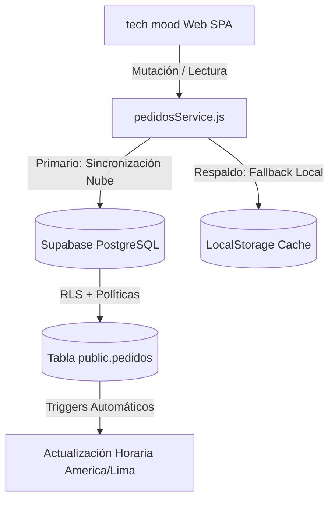

# 🚀 TechMood | Sistema Integral de Envíos y Gestión Logística

<p align="center">
  
</p>

<p align="center">
  <strong>Plataforma integral y omnicanal para la programación, despacho, seguimiento en vivo y analítica de envíos a nivel nacional (Shalom, Olva, Urbano) y distribución express local en Lima Metropolitana con motorizados propios.</strong>
</p>

<p align="center">
  
  
  
  
  
  
  
</p>

---

## 📌 Descripción del Proyecto

**TechMood - Sistema de Envíos** es una solución tecnológica integral de logística y comercio electrónico diseñada con arquitectura moderna *Single Page Application* (SPA), estética *Glassmorphism* en modo oscuro profundo y rendimiento optimizado. 

La plataforma cubre el ciclo logístico completo: desde la captura estructurada de datos del cliente sin errores hasta la asignación de couriers o motorizados, el rastreo público del pedido en tiempo real, el registro de evidencias fotográficas en ruta, la exportación masiva para empresas de paquetería y el análisis de métricas operacionales.

---

## ✨ Módulos y Características Principales

### 1. 📝 Programación de Envíos Bimodal
* 🏢 **Envíos a Provincia (Agencias Courier):**
  * Soporte multi-courier con alternancia instantánea: **Shalom Empresarial**, **Olva Courier** y **Urbano Express**.
  * Búsqueda predictiva inteligente en memoria de **más de 1,100 agencias** en todo el Perú, con tolerancia a acentos y búsqueda multi-token por distrito, provincia o departamento.
* 🛵 **Envíos Express Lima Metropolitana (Entrega Local):**
  * Cobertura por distritos oficiales de Lima Metropolitana con referencias y dirección detallada.
  * Modalidad de despacho a domicilio con asignación dinámica a repartidores propios (**Motorizado 1** o **Motorizado 2**).
  * Soporte para modalidad de pago contraentrega.
* 🛡️ **Validaciones Nativas Rigurosas:**
  * Documento de Identidad: DNI peruano (8 dígitos) o Carnet de Extranjería (9 a 12 caracteres).
  * Teléfono WhatsApp móvil válido (9 dígitos con formato nacional `9XXXXXXXX`).
  * Nombres completos validados contra expresiones regulares sin caracteres inválidos.

### 2. 🔍 Rastreo Público de Pedidos (`OrderTracking`)
* 🔎 **Búsqueda Flexible:** Consulta en tiempo real por **Código Único de Seguimiento** (formato `TM-XXXXXX`) o número de **DNI**.
* 📍 **Línea de Tiempo Dinámica y Adaptativa:**
  * **Provincia (6 etapas):** Registrado ➔ En Preparación ➔ En Agencia Origen ➔ Despachado en Courier ➔ Disponible en Agencia Destino ➔ Entregado con Éxito (con soporte de alertas para Incidencias).
  * **Lima Metropolitana (4 etapas):** Pedido Recibido ➔ Motorizado Asignado ➔ En Camino a Domicilio ➔ Entregado.
* 📋 **Información Logística Transparente:** Muestra número de guía oficial, código de seguridad/recojo emitido por el courier y enlaces de rastreo directo.

### 3. 🛡️ Panel de Administración Multi-Rol (`AdminDashboard`)
* 🔐 **Autenticación Criptográfica Segura:**
  * Acceso protegido por PIN con validación mediante hashes criptográficos **SHA-256** (`crypto.subtle`), evitando exponer contraseñas en el código cliente.
  * **Control de Acceso por Roles (RBAC):**
    * **Administrador:** Acceso ilimitado, gestión global, edición, cambio de estados y eliminación con modal de confirmación.
    * **Vendedor:** Registro, consulta y seguimiento de envíos comerciales.
    * **Supervisor:** Monitoreo logístico y reasignación de pedidos.
    * **Motorizados:** Portal enfocado exclusivamente en las entregas de su ruta.
* 🔄 **Gestión del Ciclo de Vida y Auditoría:**
  * Actualización de estados en un clic con registro en historial auditado (`historial_estados` en JSONB).
  * Asignación de guías, códigos de seguridad y couriers.
  * Envío de avisos automáticos por **WhatsApp** a clientes y supervisión con mensajes estructurados.
* 📅 **Filtro Temporal Avanzado (`FiltroFechaPremium`):**
  * Segmentación por día actual, ayer, últimos 7 días, últimos 30 días, selector por mes o rango personalizado de fechas.

### 4. 🛵 Portal de Repartidores en Ruta (`MotorizadoDashboard`)
* 📱 **Interfaz Mobile-First:** Diseñada para uso rápido en smartphones por motorizados.
* 🗺️ **Navegación Asistida:** Enlaces directos en cada dirección a **Waze** y **Google Maps**.
* 📞 **Contacto Inmediato:** Acceso directo a llamadas y chat de WhatsApp con el cliente para coordinar la llegada.
* 📸 **Captura de Doble Evidencia con Compresión en Cliente:**
  * Registro obligatorio de **Foto del Paquete Entregado** y **Foto del DNI del Receptor**.
  * Compresión automática de imágenes vía HTML5 Canvas API (`imageCompressor.js`) para acelerar la subida y optimizar el consumo de datos y almacenamiento.

### 5. 📑 Exportación Masiva Oficial a Shalom Pro (`shalomExcelExport`)
* 📊 **Generación Automatizada de Hojas de Cálculo:**
  * Integración con la plantilla oficial de Shalom Pro (`Formato-Pro-Masivo.xlsx`).
  * Mapeo de destinatarios, DNI, teléfono, tipos de mercadería y destino formateado según las reglas de carga por lote de Shalom.
  * Carga diferida de **ExcelJS** bajo demanda (*dynamic import*), reduciendo el bundle inicial de la aplicación.

### 6. 📈 Métricas y Analítica de Despachos (`AnalyticsDashboard`)
* 📊 **Gráficos Interactivos de Barras Apiladas:** Comparativa en tiempo real de volumen entre **Lima Metropolitana vs. Provincia** por días o meses.
* 🎯 **Métricas Clave (KPIs):** Total de pedidos, tasa porcentual de entregas exitosas, pedidos en tránsito, incidencias y distribución por courier.
* ⏱️ **Filtros de Período:** Vista global, vista del día actual o última semana.

---

## 🏗️ Arquitectura de Datos y Resiliencia

El sistema opera con una arquitectura híbrida de alta disponibilidad:



* **Backend Cloud (Supabase):**
  * Base de datos PostgreSQL con extensiones UUID (`uuid-ossp`).
  * Políticas de seguridad a nivel de fila (**Row Level Security - RLS**) para consultas, inserciones y actualizaciones.
  * Triggers en PL/pgSQL para actualización automática de fecha y hora local de Perú (`America/Lima`) en cada modificación y registro de `fecha_entregado`.
  * Índices B-Tree optimizados en columnas clave (`codigo_seguimiento`, `dni_cliente`, `estado`, `tipo_envio`, `fecha_entregado`).
* **Resiliencia Local (LocalStorage Fallback):**
  * Si la conexión a Supabase presenta intermitencias o no se configuran credenciales, el sistema conmuta automáticamente a almacenamiento local seguro, garantizando cero interrupciones en la atención al cliente.

---

## 🛠️ Tecnologías Utilizadas

| Categoría | Tecnología | Uso en el Proyecto |
| :--- | :--- | :--- |
| **Frontend** | [React 19](https://react.dev/) + React Compiler | Componentes funcionales reactivos y renderizado de alto rendimiento. |
| **Bundler & Build** | [Vite 8](https://vitejs.dev/) | Entorno de desarrollo ultrarrápido y empaquetado optimizado. |
| **Estilos** | [Tailwind CSS v4](https://tailwindcss.com/) | Sistema de diseño moderno, variables CSS nativas y utilidades responsivas. |
| **Base de Datos** | [Supabase](https://supabase.com/) (PostgreSQL) | Persistencia relacional, seguridad RLS, triggers e índices. |
| **Hojas de Cálculo** | [ExcelJS](https://github.com/exceljs/exceljs) | Carga, manipulación y descarga masiva de plantillas Excel oficiales. |
| **Iconografía** | [Lucide React](https://lucide.dev/) | Iconos vectoriales consistentes y ligeros. |
| **Procesamiento Gráfico** | HTML5 Canvas API | Compresión y reducción de peso de fotos de evidencia en el cliente. |
| **Seguridad** | Web Crypto API (`crypto.subtle`) | Hashing criptográfico SHA-256 para validación de PINs sin fuga de claves. |
| **Hosting & CDN** | [Vercel](https://vercel.com/) | Despliegue continuo con configuración SPA y cabeceras de seguridad HTTP. |

---

## 📁 Estructura del Proyecto

```text
Sistema Pedidos/
├── public/
│   ├── Formato-Pro-Masivo-2026_10_08_21.xlsx # Plantilla oficial de Shalom Pro
│   └── favicon y recursos estáticos
├── src/
│   ├── assets/
│   │   └── logo.png                          # Logotipo oficial tech mood
│   ├── components/
│   │   ├── AdminDashboard.jsx                # Panel de control de pedidos, estados y exportaciones
│   │   ├── AgencySearch.jsx                  # Buscador predictivo de agencias para Provincia
│   │   ├── AnalyticsDashboard.jsx            # Gráficos de barras apiladas y métricas logísticas
│   │   ├── BottomNav.jsx                     # Barra de navegación flotante inferior para móviles
│   │   ├── CustomSelect.jsx                  # Select interactivo estilizado
│   │   ├── DistrictSearch.jsx                # Selector predictivo de distritos de Lima Metropolitana
│   │   ├── FiltroFechaPremium.jsx            # Filtro temporal avanzado (presets, meses y rangos)
│   │   ├── Header.jsx                        # Encabezado superior con switch de vistas y status 24/7
│   │   ├── MotorizadoDashboard.jsx           # Portal para repartidores (rutas, llamadas y fotos)
│   │   └── OrderTracking.jsx                 # Módulo público de consulta y rastreo de envíos
│   ├── data/
│   │   ├── distritosLima.json                # Cobertura y nombres normalizados de Lima
│   │   ├── olva.json                         # Directorio oficial de agencias Olva Courier
│   │   ├── shalom.json                       # Directorio oficial de agencias Shalom
│   │   └── urbano.json                       # Directorio oficial de agencias Urbano Express
│   ├── lib/
│   │   └── supabase.js                       # Inicialización del cliente Supabase
│   ├── services/
│   │   └── pedidosService.js                 # Capa de datos (CRUD, sync Supabase y códigos TM)
│   ├── utils/
│   │   ├── imageCompressor.js                # Compresión de fotos en navegador con Canvas
│   │   └── shalomExcelExport.js              # Procesador de exportación masiva Shalom Pro
│   ├── App.jsx                               # Enrutador central y formulario de despacho
│   ├── index.css                             # Tokens globales y estilos base Tailwind v4
│   └── main.jsx                              # Punto de montaje del DOM
├── supabase/
│   └── schema.sql                            # DDL completo de base de datos, RLS e índices
├── .env.example                              # Plantilla de variables de entorno seguras
├── vercel.json                               # Configuración de rutas SPA y cabeceras de seguridad
├── vite.config.js                            # Configuración de Vite con plugins de React y Tailwind
└── package.json                              # Scripts y dependencias del proyecto
```

---
<!-- 
## 🚀 Instalación y Puesta en Marcha Local

### 1. Clonar el repositorio
```bash
git clone https://github.com/tu-usuario/sistema-envios-techmood.git
cd "sistema-envios-techmood"
```

### 2. Instalar dependencias
```bash
npm install
```

### 3. Configurar variables de entorno
Copia la plantilla de ejemplo para crear tu archivo `.env` local:
```bash
cp .env.example .env
```
Edita `.env` con los valores correspondientes a tu proyecto:
```env
# Conexión con Supabase
VITE_SUPABASE_URL=https://tu-proyecto.supabase.co
VITE_SUPABASE_ANON_KEY=tu_clave_anonima_publica_aqui

# PINs de acceso por Rol (Ingresa contraseñas seguras para tu equipo)
VITE_ADMIN_PIN=tu_pin_admin_seguro
VITE_VENDEDOR_PIN=tu_pin_vendedor_seguro
VITE_M1_PIN=tu_pin_motorizado1_seguro
VITE_M2_PIN=tu_pin_motorizado2_seguro
VITE_M_ALL_PIN=tu_pin_supervisor_seguro
```

### 4. Inicializar la Base de Datos (Supabase)
1. Ingresa a la consola de [Supabase](https://supabase.com/).
2. Crea un proyecto nuevo o selecciona el actual.
3. Dirígete a la pestaña **SQL Editor**.
4. Abre el archivo `supabase/schema.sql` del proyecto, copia su contenido, pégalo en el editor y haz clic en **Run**.
5. Las tablas, extensiones UUID, índices y políticas de seguridad (RLS) quedarán configuradas automáticamente.

### 5. Iniciar el servidor de desarrollo
```bash
npm run dev
```
La aplicación se iniciará de inmediato en `http://localhost:5173`.

### 6. Compilar para producción
```bash
npm run build
```

---

## 🌐 Despliegue en Vercel

El proyecto incluye el archivo `vercel.json` con optimizaciones de producción:
* Rutas de reescritura para aplicaciones SPA (`/* -> /index.html`).
* Cabeceras de seguridad HTTP (`X-Content-Type-Options: nosniff`, `X-Frame-Options: DENY`, `Referrer-Policy: strict-origin-when-cross-origin`).

### Pasos para desplegar:
1. Sube tu código a un repositorio en **GitHub**.
2. Ingresa a tu panel en [Vercel](https://vercel.com) y selecciona **"Add New Project"**.
3. Importa el repositorio del proyecto.
4. En la sección **Environment Variables**, añade las variables definidas en tu `.env`:
   * `VITE_SUPABASE_URL`
   * `VITE_SUPABASE_ANON_KEY`
   * `VITE_ADMIN_PIN`, `VITE_VENDEDOR_PIN`, `VITE_M1_PIN`, `VITE_M2_PIN`, `VITE_M_ALL_PIN`
5. Haz clic en **Deploy**. El sitio quedará operativo en la red de Vercel con certificado SSL automático. -->

---

## 🔒 Auditoría y Seguridad

* **Protección Criptográfica:** Los PINs de roles no se validan en texto plano en el cliente; se contrastan mediante hashes SHA-256 utilizando la API estándar `window.crypto.subtle`.
* **Políticas RLS en Base de Datos:** Acceso controlado mediante Row Level Security en PostgreSQL.
* **Higiene de Secretos:** `.gitignore` configurado estrictamente para evitar la exposición accidental de `.env`, claves y directorios de compilación.
* **Seguridad en Redirecciones:** Enlaces salientes protegidos con atributos `noopener,noreferrer` contra vulnerabilidades de *tabnabbing*.

---

## 📄 Licencia y Derechos

Este software es propiedad y desarrollo exclusivo para **TechMood**. Todos los derechos reservados © 2026.
